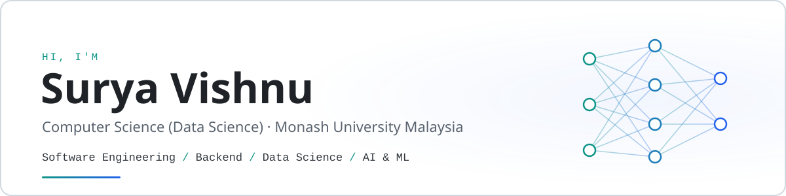

<picture>
  <source media="(prefers-color-scheme: dark)" srcset="assets/banner-dark.svg">
  <source media="(prefers-color-scheme: light)" srcset="assets/banner-light.svg">
  
</picture>

  

## About me

I'm a Computer Science student majoring in Data Science at Monash University Malaysia. I enjoy building software end to end, from the database and API layer up to the interface, and I'm just as interested in the machine learning side: training models, running careful experiments, and understanding why they work.

<table>
  <tr>
    <td width="50%" valign="top">
      <b>Software &amp; app development</b> 
      An offline-first Android app in Kotlin and Jetpack Compose, and a full-stack API mocking tool with a FastAPI backend and a React frontend.
    </td>
    <td width="50%" valign="top">
      <b>Machine learning &amp; computer vision</b> 
      Fine-tuning pretrained CNNs and vision transformers in PyTorch, and implementing optimisers, losses and augmentation methods from scratch.
    </td>
  </tr>
  <tr>
    <td width="50%" valign="top">
      <b>Research software</b> 
      Developing a desktop application for multi-omics data analysis as part of a university research project.
    </td>
    <td width="50%" valign="top">
      <b>Databases &amp; API integration</b> 
      Relational schemas and SQL analytics in SQLite and Room, REST clients with Retrofit, and LLM integration through the Gemini API.
    </td>
  </tr>
</table>

## Tech stack

<table>
  <tr>
    <td><b>Languages</b></td>
    <td>
      
      
      
      
      
      
    </td>
  </tr>
  <tr>
    <td><b>Frameworks &amp; libraries</b></td>
    <td>
      
      
      
      
      
      
      
    </td>
  </tr>
  <tr>
    <td><b>ML &amp; data science</b></td>
    <td>
      
      
      
      
      
      
      
      
      
    </td>
  </tr>
  <tr>
    <td><b>Databases</b></td>
    <td>
      
      
      
    </td>
  </tr>
  <tr>
    <td><b>Tools &amp; cloud</b></td>
    <td>
      
      
      
      
      
      
      
      
    </td>
  </tr>
</table>

## Featured projects

<table>
  <tr>
    <td width="50%" valign="top">
      <h3><a href="https://github.com/NotSury/medtrack-pro">MedTrack Pro</a></h3>
      
Android app for medication and symptom tracking, with FDA drug label lookup, AI-assisted adherence tips and an anonymised clinician dashboard.

      
<b>Highlight:</b> offline-first design with Room as the single source of truth. Clinician statistics are computed with SQL aggregate queries, and AI prompts are built from a projection that excludes patient identifiers.

      
<code>Kotlin</code> <code>Jetpack Compose</code> <code>MVVM</code> <code>Room</code> <code>Retrofit</code> <code>OpenFDA</code> <code>Gemini</code>

    </td>
    <td width="50%" valign="top">
      <h3><a href="https://github.com/NotSury/animal-image-classification">20-Class Image Classification</a></h3>
      
Comparison of CNNs and pretrained vision transformers (ResNet18, EfficientNet-B3, CLIP, SigLIP2, Perception Encoder) on a 20-class Kaggle image task.

      
<b>Highlight:</b> two-stage fine-tuning of a DFN5B CLIP ViT-H/14 reached <b>95.11%</b> on the Kaggle leaderboard. A separate Perception Encoder experiment with style-aware augmentation reached 96.93%.

      
<code>PyTorch</code> <code>OpenCLIP</code> <code>Hugging Face</code> <code>Transfer learning</code> <code>Computer vision</code>

    </td>
  </tr>
  <tr>
    <td width="50%" valign="top">
      <h3><a href="https://github.com/NotSury/MockDock">MockDock</a></h3>
      
Local-first API mocking and debugging studio. Define fake REST endpoints in a web UI and serve them from a real HTTP server, with latency and failure simulation and a request inspector.

      
<b>Highlight:</b> the mock server reads configuration on every request, so edits apply without a restart. Covered by 79 backend and 36 frontend tests, with credentials redacted before requests are logged.

      
<code>FastAPI</code> <code>SQLAlchemy</code> <code>SQLite</code> <code>React</code> <code>TypeScript</code> <code>pytest</code> <code>Vitest</code>

    </td>
    <td width="50%" valign="top">
      <h3><a href="https://github.com/NotSury/Deep-Learning-Experiments">Deep Learning Experiments</a></h3>
      
Neural network implementations and controlled training experiments, from a feed-forward network built on raw parameter tensors to a configurable residual CNN.

      
<b>Highlight:</b> SGD, momentum and AdaGrad written as manual updates, and Sharpness-Aware Minimization implemented as a <code>torch.optim.Optimizer</code> subclass. Also compares Mixup, CutMix, One-vs-All loss and rotation self-supervision.

      
<code>PyTorch</code> <code>torchvision</code> <code>NumPy</code> <code>SciPy</code> <code>Matplotlib</code>

    </td>
  </tr>
</table>

---

  Open to internship opportunities in software engineering, backend development, data science and ML. The best way to reach me is on <a href="https://www.linkedin.com/in/surya-vishnu-4b59b9328/">LinkedIn</a>.

